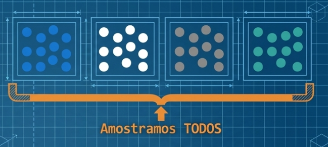

## ⏳Aula passada

<br>

- Definir os estimadores tipos regressão: AAS

- Obtenção do tamanho da amostra

- Exemplos de aplicação

- Avaliação 1

# Amostragem por conglomerado {background-gradient="linear-gradient(135deg, #002B49 0%, #7A2E16 100%)"}


## ✨ Motivação {style="font-size: 0.75em;"}

<br>

::: {.columns}

::: {.column width="50%"}


A amostragem aleatória simples requer um cadastro completo de todos os elementos da população
:::

::: {.column width="50%"}

:::{.fragment}


Elementos espalhados geograficamente
:::
:::
:::

---

<br>

::: {.columns}

::: {.column width="50%"}

<div style="text-align: center;">

</div>
:::

::: {.column width="50%"}

<br>
<br>

::: {.callout-tip title="Ideia"}
**MUDAR** a unidade amostral
:::
:::
:::

---

<iframe src="fig-am2/teste.html" width="100%" height="800px" style="border:none;"></iframe>

---

<br>

::: {.columns}

::: {.column width="50%"}
Amostragem estratificada


:::

::: {.column width="50%"}

:::{.fragment}
Amostragem por conglomerado


:::
:::
:::

## 📘 Um estágio {style="font-size: 0.75em;"}

:::{.justificado}
**Exemplo 1**: Um pesquisador deseja estimar a renda per capita dos habitantes de uma cidade. Como não existe uma listagem cadastral de todos os moradores (elementos da população), optou-se pelo uso da Amostragem por Conglomerados em Um Estágio.   A cidade foi mapeada e dividida em um total de $N = 415$ conglomerados (compostos por quarteirões residenciais, além de agrupamentos de áreas industriais e parques). Por restrições orçamentárias e de tempo, selecionou-se uma amostra aleatória simples de $n = 5$ conglomerados. Em cada um dos $5$ conglomerados sorteados, realizou-se um censo local, entrevistando-se todos os domicílios e moradores.  
:::

```{=html}
<head>
<meta charset="UTF-8">
<style>
  table {
    border-collapse: collapse;
    width: 100%;
    font-family: serif;
    font-size: 23px;
    border-right: none; /* Garante que a tabela não tem borda direita */
  }
  
  th, td {
    padding: 8px 12px;
    text-align: left;
    border-bottom: 1px solid #ccc; /* Linhas horizontais entre as linhas */
    border-right: none; /* Garante que nenhuma célula tem borda vertical à direita */
  }

  /* Linha superior e inferior do cabeçalho */
  th {
    border-top: 1px solid black;
    border-bottom: 1px solid black;
    font-weight: bold;
  }

  /* Linha horizontal final abaixo da última linha de dados */
  tbody tr:last-child td {
    border-bottom: 1px solid black;
  }
</style>
</head>
<body>

<table>
  <thead>
    <tr>
      <th>Conglomerado</th>
      <th>Número de<br>residentes</th>
      <th>Renda total por conglomerado <br> (em milhares de reais)</th>
    </tr>
  </thead>
  <tbody>
    <tr>
      <td>1</td>
      <td>8</td>
      <td>96</td>
    </tr>
    <tr>
      <td>2</td>
      <td>12</td>
      <td>121</td>
    </tr>
    <tr>
      <td>3</td>
      <td>4</td>
      <td>42</td>
    </tr>
    <tr>
      <td>4</td>
      <td>5</td>
      <td>65</td>
    </tr>
    <tr>
      <td>5</td>
      <td>6</td>
      <td>52</td>
    </tr>
  </tbody>
</table>

</body>
```

---

Com base nos dados da amostra recolhida nos $5$ conglomerados:   

- Estime a renda per capita ($\mu$) da população da cidade.   

- Determine a margem de erro, considerando 95% de confiança. 

---

<div style="text-align: center;">

</div>